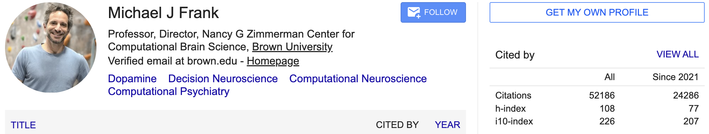

##  {.copertina .center}

::::: columns
::: {.column width="64%"}
[Le skill: che cosa sono e come si usano]{.titolo}

[Pratica con la skill fair-check]{.sottotitolo}

[Margherita Calderan]{.autrice}\
[Dipartimento di Psicologia Generale, Università di Padova]{.affiliazione}
:::

::: {.column .qr width="36%"}
{fig-alt="QR code che porta a queste slide"}

Queste slide:\
[mar-cald.github.io/fair/skill/slides.html](https://mar-cald.github.io/fair/skill/slides.html)
:::
:::::

## Che cosa facciamo oggi

1.  Cos'è una skill?
2.  Proviamo `fair-check`, una skill che controlla la cartella di un progetto di ricerca prima del deposito.
3.  Vediamo come scriverne una (se avanza tempo).

::: fonte
La prima parte riprende le slide [*Evocare gli agents*](https://enricotoffalini.github.io/evocare-agents) di Enrico Toffalini.
:::

# Che cos'è una skill {.sezione}

## Gli assistenti AI

Si usano in due modi.

-   Nel browser, su claude.ai o chatgpt.com. L'assistente vede solo il testo che scrivete e i file che allegate.

-   Sul computer, con l'app Claude oppure GPT. Qui l'assistente può aprire i file di una cartella ed eseguire programmi, dopo avervi chiesto il permesso.

## Chiedete un'analisi in R

::: richiesta
Calcola la media dei tempi di reazione per condizione.
:::

L'assistente risponde, per esempio, così:

``` r
library(tidyverse)

calcola_medie <- function(dati) {
  dati %>%
    group_by(condizione) %>%
    summarise(media = mean(rt))
}
```

## Il codice funziona, ma non è il vostro

Voi usate la pipe `|>`, e per tre righe non scrivete una funzione.

L'assistente non può saperlo: ha scritto il codice nel modo più diffuso.

## Potete correggerlo

::: richiesta
Riscrivilo con la pipe \|\> e senza funzione.
:::

L'assistente lo riscrive come volete.

Alla prossima conversazione, però, di solito la correzione va ripetuta. E così ogni volta che chiedete del codice R.

## Una skill è la correzione scritta una volta sola

Scrivete in un file come volete che sia fatto un certo tipo di lavoro.

L'assistente legge quel file ogni volta che gli chiedete quel tipo di lavoro.

## Una semplice skill: una cartella con un file

::: {.cartella .stretta}
-    **my-style-r**
    -    **SKILL.md**
:::

La cartella ha il nome della skill. Il file si chiama sempre `SKILL.md` ed è un file di testo.

## Dentro `SKILL.md`

``` markdown
---
name: my-stily-r
description: Il mio stile per il codice R. Da usare ogni
  volta che si scrive o si corregge codice R.
---

- Usa la pipe nativa |> e non %>%.
- Scrivi script dall'alto in basso: una funzione solo
  se lo stesso blocco si ripete tre volte.
- Usa <- per l'assegnazione.
```

In alto ci sono il nome e la descrizione. Sotto ci sono le istruzioni. Potete anche chiedere all'AI di usare come esempio dei vostri vecchi script.

## Come fa l'assistente a sapere quando usarla

All'inizio di ogni conversazione l'assistente legge solo il nome e la descrizione delle skill installate. Quando la vostra richiesta corrisponde a una descrizione, apre quel `SKILL.md` e segue le istruzioni.

-   Con questa descrizione l'assistente **non capisce** quando serve:

``` markdown
description: Stile di codice.
```

-   Con questa **sì**:

``` markdown
description: Il mio stile per il codice R. Da usare ogni
  volta che si scrive o si corregge codice R.
```

## Lo stesso esempio, con la skill installata

::: richiesta
Calcola la media dei tempi di reazione per condizione in R.
:::

La richiesta riguarda codice R. La descrizione di `my-style-r` dice «ogni volta che si scrive o si corregge codice R». L'assistente apre `SKILL.md` e risponde:

``` r
dati |>
  aggregate(rt ~ condizione, data = _, FUN = mean)
```

## Potete anche chiamarla per nome

Se volete essere sicuri che l'assistente la usi, scrivete il nome della skill nella richiesta.

In Claude Code:

::: richiesta
/my-style-r calcola la media dei tempi di reazione per condizione.
:::

In Codex:

::: richiesta
\$my-style-r calcola la media dei tempi di reazione per condizione.
:::

# La skill fair-check {.sezione}

## Che cosa fa

`fair-check` controlla la cartella di un progetto di ricerca prima del deposito su Zenodo o su un altro repository.

Applica i principi [FAIR](https://mar-cald.github.io/fair/) e risponde a una domanda: una persona che non vi conosce riuscirebbe a trovare, aprire, capire e riusare questi dati e questo codice? I risultati riportati nel manoscritto corrispondono a quelli che si ottengono dai dati?

## Che cosa segnala, per esempio

::: segnalazione
Nella colonna `eta` c'è un valore 150.
:::

::: segnalazione
La colonna `genere` contiene sia `F` sia `Femmina`.
:::

::: segnalazione
Nel file dei dati la media è 96.16. Nella Tabella 1 del manoscritto è 89.77.
:::

::: segnalazione
Lo script `02_analisi.R` si ferma: contiene `setwd()` con un percorso che esiste solo sul vostro computer.
:::

## Che cosa vi restituisce

Un rapporto con i problemi trovati, file per file.

Se lo chiedete, anche **una copia della cartella** pronta da depositare, con README, data dictionary e licenze. Analisi rigirate correggendo eventuali errori.

La **vostra cartella non viene modificata**.

## Il rapporto troverà dei problemi



Questo mese ha fatto controllare a Claude Code, i 59 articoli empirici che ha firmato negli ultimi cinque anni.

::: fonte
[*An AI audit of my work's computational reproducibility*](https://babieslearninglanguage.blogspot.com/2026/11/an-ai-audit-of-my-works-computational.html), 10 novembre 2026.
:::

## Che cosa ha trovato

::: cifre
-   [31 su 58]{.cifra} articoli si potevano rieseguire per intero dai dati e dal codice pubblicati.
-   [40 su 58]{.cifra} avevano almeno un numero che non si riproduceva.
-   [Più di metà]{.cifra} conteneva almeno un errore nelle analisi, secondo la sua stima. Il più grave invalida il risultato di un articolo.
:::

## Com'è fatta fair-check

::: cartella
-    **fair-check**
    -    **SKILL.md** [le istruzioni principali]{.cosa}
    -    **references** [istruzioni di dettaglio]{.cosa}
        -    check-data.md
        -    check-code.md
        -    [altri 4 file]{.cosa}
    -    **scripts** [programmi in Python]{.cosa}
        -    fair_scan.py
        -    [altri 9 file]{.cosa}
:::

È più grande di `my-style-r`: oltre a `SKILL.md` contiene altre istruzioni e dei programmi.

## L'assistente legge solo le istruzioni che servono

`SKILL.md` è corto. Dice all'assistente quale file di `references` aprire per ciascun controllo.

Se chiedete di controllare solo il codice, l'assistente apre `check-code.md`. Il file sui dati, `check-data.md`, non lo legge.

## I programmi leggono i file al posto dell'assistente

`fair_scan.py` apre tutti i file della cartella e scrive un riassunto: quali colonne ci sono, che valori contengono, che cosa non torna.

L'assistente legge il riassunto. Non apre i dati un file alla volta.

Altri programmi eseguono il codice in una copia della cartella, cercano nei risultati i numeri del manoscritto e ricalcolano quelli che non tornano.

## Perché conta: i token

Il servizio misura in *token*, cioè parole o pezzi di parola, tutto il testo che l'assistente legge e scrive. I limiti del vostro abbonamento si contano in token.

Una skill fatta così ne consuma meno: l'assistente legge poche istruzioni e un riassunto, non tutta la cartella.

# Prima di provarla: i vostri dati {.sezione}

## Il modello AI non gira sul vostro computer

Gira sui server dell'azienda che fornisce il servizio: Anthropic per Claude, OpenAI per ChatGPT.

Tutto quello che l'assistente legge viene inviato a quei server.

## Che cosa viene inviato

Se lavorate sul computer, vengono inviati i file che l'assistente apre e i risultati dei programmi che esegue. Gli altri file restano sul computer.

Se lavorate nel browser, viene inviato l'intero zip che allegate.

Il riassunto scritto da `fair_scan.py` contiene tipi, intervalli e conteggi, non le righe dei dati, e nasconde i valori delle colonne che sembrano dati personali.

## I dati inviati possono servire ad addestrare i modelli

Dipende da un'impostazione del vostro account. In Claude, nei piani Free, Pro e Max, si trova qui:

::: percorso
Settings → Privacy → Help improve our AI models
:::

Se è attiva, le vostre conversazioni possono essere usate per addestrare i modelli futuri e vengono conservate fino a 5 anni.

Gli altri servizi hanno un'impostazione dello stesso tipo.

::: fonte
Fonti: [come cambiare l'impostazione](https://privacy.claude.com/en/articles/12109829-how-do-i-change-my-model-improvement-privacy-settings), [che cosa cambia](https://www.anthropic.com/news/updates-to-our-consumer-terms) (Anthropic).
:::

## Disattivatela, ma non basta

Con l'impostazione disattivata le conversazioni non vengono usate per l'addestramento, salvo quelle segnalate per i controlli di sicurezza.

Restano comunque sui server per 30 giorni.

Per oggi usate una cartella senza dati sensibili, oppure una copia da cui avete tolto le colonne personali.

# Proviamola {.sezione}

## [Passo 1]{.passo} Scaricate la skill

Il file da scaricare dipende dall'assistente che usate.

Claude, nell'app per computer o su claude.ai:

[fair-check.skill](https://mar-cald.github.io/fair/skill/fair-check.skill){.scarica}

Claude Code, Codex o ChatGPT:

[fair-check.zip](https://mar-cald.github.io/fair/skill/fair-check.zip){.scarica}

I due file contengono la stessa cartella, `fair-check`.

## [Passo 2]{.passo} Con Claude: caricate il file

Nelle impostazioni di Claude, nella sezione delle skill, caricate `fair-check.skill`.

Deve essere attiva l'esecuzione di codice, che si trova nelle stesse impostazioni.

La skill diventa disponibile in tutte le conversazioni.

## [Passo 2]{.passo} Con Claude Code, Codex o ChatGPT: chiedetelo all'assistente

Questi assistenti possono aprire file e copiarli. Scrivete:

::: richiesta
Installa la skill che ho scaricato: è il file fair-check.zip nella cartella Download. Estrailo e copia la cartella fair-check nella cartella delle skill che usi.
:::

L'assistente sa dove tiene le sue skill. Prima di copiare la cartella vi chiede il permesso.

Poi aprite una nuova conversazione: l'elenco delle skill si legge all'inizio di ogni conversazione, come abbiamo visto.

## Che cosa serve sul computer

Python 3, per i programmi della skill.

R, per eseguire il vostro codice R. Se manca, la skill legge il codice ma non lo esegue, e il rapporto lo dice all'inizio.

## [Passo 3]{.passo} Aprite una cartella e chiedete

Aprite nell'assistente la cartella di un vostro progetto. Nel browser, allegatela come zip.

Poi scrivete:

::: richiesta
Controlla se questa cartella è pronta da depositare su Zenodo.
:::

L'assistente riconosce la richiesta dalla descrizione di `fair-check`, come abbiamo visto con `my-style-r`. Nella conversazione compare il momento in cui apre `SKILL.md`.

## Potete chiedere anche solo una parte

::: richiesta
Controlla solo il codice: gira su un altro computer?
:::

::: richiesta
I numeri del preprint escono dai dati e dagli script?
:::

## [Passo 4]{.passo} Rispondete alle domande

Prima di cominciare la skill vi fa alcune domande, tutte insieme. Per esempio:

::: segnalazione
Che cosa controllo? Dati e documentazione, codice, numeri del manoscritto, versione da depositare.
:::

::: segnalazione
Dove depositerete la cartella?
:::

Per oggi rispondete «dati e documentazione». Eseguire tutto il codice può richiedere molto tempo, e consuma token.

## [Passo 5]{.passo} Leggete il rapporto

È scritto in italiano e comincia dalle cose più importanti.

1.  I risultati che potrebbero cambiare, se ce ne sono.
2.  Le domande aperte: quello che non ha potuto né spiegare né confermare.
3.  Una tabella con lo stato di ogni area: dati, README, licenza, codice…
4.  I problemi, uno per uno, con il file e la riga in cui si trovano.
5.  Le cinque o sei cose da sistemare per prime.

Quello che la skill non ha potuto controllare è scritto, con il motivo.

## Nel rapporto finisce solo quello che è stato verificato

Prima di scrivere il rapporto, l'assistente prova a spiegare ogni differenza che ha trovato.

Una correlazione diversa da quella della Tabella 2 può essere un errore. Ma può anche essere una correlazione di Spearman invece che di Pearson, o un calcolo fatto dopo le esclusioni. Un programma della skill prova da solo queste varianti e dice quale dà il valore dell'articolo.

Se nessuna spiegazione regge, la differenza va tra i risultati che potrebbero cambiare. Se non ha potuto verificarle tutte, ve la presenta come una domanda.

## [Passo 6]{.passo} Verificate una segnalazione

Scegliete una segnalazione del vostro rapporto. Per esempio:

::: segnalazione
Nella colonna `eta` c'è un valore 999.
:::

Aprite il file e guardate: il valore c'è davvero?

Se una segnalazione non vi convince, chiedete all'assistente da quale file e da quale riga l'ha ricavata.

## Che cosa fare di un errore lo decidete voi

Un 999 nell'età può essere un codice per il dato mancante oppure un errore di battitura. La skill lo segnala, ma non sa quale dei due.

Se un errore nei dati cambia un risultato, può servire una correzione all'articolo, non solo alla cartella.

## Potete chiedere di rifare le analisi con la correzione

Se il rapporto trova errori che cambiano i risultati, alla fine vi chiede: volete che rifaccia le analisi con le correzioni?

Se rispondete di sì, corregge una copia della cartella, esegue di nuovo il codice e vi dice quali numeri dell'articolo cambiano e di quanto. Se non rispondete, non lo fa. Per esempio:

::: segnalazione
Con l'età 999 trattata come dato mancante, la correlazione della Tabella 2 passa da r = .34 a r = .31; la conclusione non cambia.
:::

La vostra cartella resta com'è.

## [Passo 7]{.passo} Se avete tempo: la versione da depositare

::: richiesta
Prepara la versione da depositare.
:::

:::::: columns
:::: {.column width="46%"}
::: cartella
-    **progetto_deposit**
    -    README.md
    -    LICENSE
    -    data
    -    dictionaries
    -    scripts
    -    output
:::
::::

::: {.column width="54%"}
Prima di crearla, l'assistente vi mostra il piano e vi chiede che cosa lasciare fuori, quali colonne personali togliere e quali licenze usare.

Nel data dictionary, quello che non trova scritto da nessuna parte resta `TODO`: lo completate voi.
:::
::::::

# Scriverne una {.sezione}

## Partite da una correzione che fate spesso

`my-style-r` è nata così: dalla richiesta «riscrivilo con la pipe `|>`», ripetuta troppe volte.

Non serve un documento completo. Bastano tre regole, e ne aggiungete una quando l'assistente sbaglia di nuovo.

## Scrivete regole precise

Questa regola l'assistente non sa come applicarla:

``` markdown
- Scrivi codice chiaro.
```

Questa sì:

``` markdown
- Usa <- per l'assegnazione.
```

Scrivete anche che cosa non deve fare: «non installare pacchetti senza chiedere».

## Fatevi aiutare dall'assistente

Dategli alcuni vostri script e chiedetegli di ricavarne le regole che seguite.

::: richiesta
Leggi questi tre script e scrivi uno SKILL.md con il mio stile di codice R.
:::

Poi leggete quello che ha scritto e correggetelo.

## Le skill degli altri leggetele prima di installarle

Una skill può contenere programmi, come `fair_scan.py`. L'assistente li esegue sul vostro computer, con i vostri permessi.

`SKILL.md` e i programmi sono file di testo: si possono aprire e leggere prima di installare la cartella.

::: fonte
Le indicazioni di questa parte sono tratte da *Evocare gli agents* di Enrico Toffalini.
:::

## Crediti e link {.medio}

La parte sulle skill è adattata dal lavoro di Enrico Toffalini:

-   le slide [*Evocare gli agents*](https://enricotoffalini.github.io/evocare-agents) (lab meeting Memory & Learning, 4 novembre 2026)
-   la serie [*Tre cose sull'AI*](https://enricotoffalini.github.io/blog/posts/serie-ai/): agenti in locale, ChatGPT Edu, skill

Per `fair-check`:

-   come installarla e usarla: [mar-cald.github.io/fair/skill.html](https://mar-cald.github.io/fair/skill.html)
-   tutto quello che fa, passo per passo: [mar-cald.github.io/fair/skill-dettagli.html](https://mar-cald.github.io/fair/skill-dettagli.html)
-   i sorgenti: [github.com/mar-cald/fair/tree/main/skill](https://github.com/mar-cald/fair/tree/main/skill)

Il post di Michael Frank: [*An AI audit of my work's computational reproducibility*](https://babieslearninglanguage.blogspot.com/2026/11/an-ai-audit-of-my-works-computational.html)

Il formato delle skill: [agentskills.io](https://agentskills.io)
